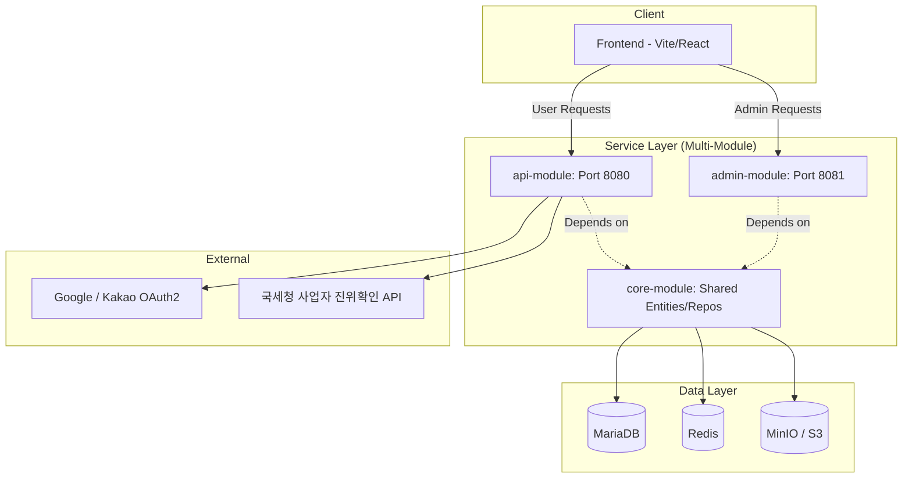
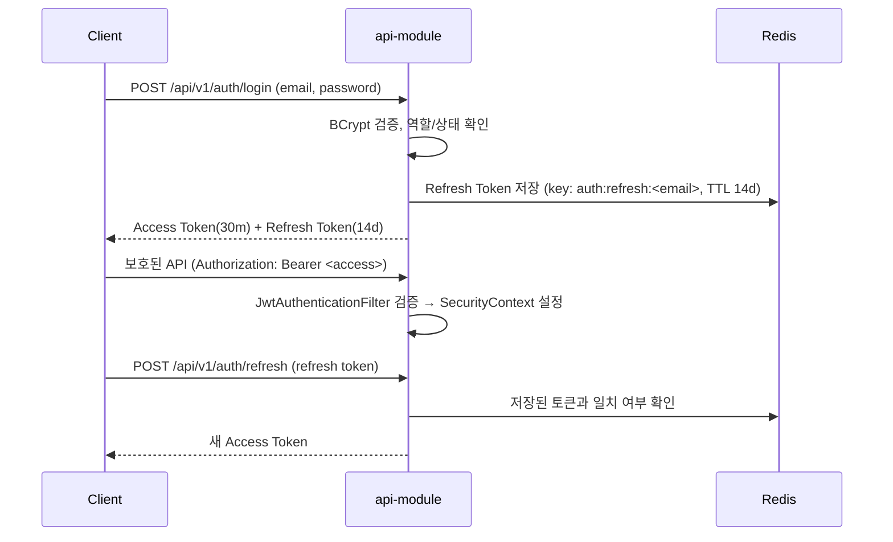

# ✈️ Onde (온데) Backend - 통합 여행 및 예약 플랫폼

> **Onde**는 항공권, 숙박, 렌터카 등 여행에 필요한 서비스를 한곳에서 예약하고 관리하는 통합 여행 플랫폼입니다.
> 백엔드는 **Spring Boot 멀티 모듈 아키텍처**로, 공통 도메인(core)과 사용자/판매자 API(api), 관리자 API(admin)를 분리했습니다.
>
> SK쉴더스 루키즈 개발 5기 최종 프로젝트. 관련 저장소: [Onde_Frontend](https://github.com/UR-VULN/Onde_Frontend) · [Onde_Infra](https://github.com/UR-VULN/Onde_Infra)

---

## 1. 프로젝트 소개
* **프로젝트 명**: Onde (온데)
* **개발 목적**: 항공, 숙박, 렌터카 서비스를 유기적으로 연결하여 끊김 없는 사용자 여행 경험을 제공하고, 관리자에게는 매출 관리 및 파트너 어드민 도구를 지원합니다.
* **핵심 지향점**:
  * **멀티 모듈 구조**: 공통 도메인 영역과 사용자·판매자 / 관리자 서비스를 분리하여 각 모듈이 독립적으로 빌드·배포됩니다.
  * **안정적인 예약 관리**: Redisson 분산 락 기반 동시성 제어와 실시간 재고 관리.
  * **보안을 고려한 인증**: Stateless JWT + Redis Refresh Token, OAuth2 소셜 로그인, 역할(Role) 기반 접근 제어.

---

## 2. 주요 기능
### 👤 인증 / 인가 (Spring Security + JWT + OAuth2)
* **JWT 인증 모듈**: 회원가입 · 로그인 · 토큰 재발급 API (`/api/v1/auth/**`).
  * Access Token 30분 / Refresh Token 14일 (`jwt.*` 설정으로 조정 가능).
  * Refresh Token은 **Redis**(`@RedisHash`, TTL 자동 만료)에 이메일 단위로 저장해 중복 로그인과 재발급을 관리합니다.
  * 토큰은 `Authorization: Bearer` 헤더 또는 HttpOnly 쿠키 두 경로 모두에서 읽습니다.
* **OAuth2 소셜 로그인 (Google / Kakao)**: `spring-boot-starter-oauth2-client` 기반.
  * 소셜 계정에 이메일이 없으면 `GUEST`로 가입시킨 뒤 이메일 인증(`/api/v1/auth/email/**`, Redis 3분 TTL 인증번호 발급·검증)을 거쳐 `USER`로 승격하는 **단계적 온보딩 플로우**. (인증번호 발급·검증 API까지 구현되어 있고, 실제 메일 발송 연동은 미구현 상태입니다.)
* **역할 기반 접근 제어**: `USER`, `SELLER`, `SUPER_ADMIN`, `USER_ADMIN`, `SELLER_ADMIN` 권한별로 사용자 / 판매자 / 관리자 API 접근 범위를 분리. 기본값은 `authenticated()`로 막고 공개 경로만 명시적으로 허용합니다.
* 401 / 403 응답은 공통 JSON 에러 포맷(`JwtAuthenticationEntryPoint`, `JwtAccessDeniedHandler`)으로 통일.

### 🚗 실시간 렌터카 검색 및 예약
* **위치 기반 차량 검색**: 주요 도시별 차량 목록 필터링.
* **재고 및 요금 실시간 조회**: 렌터카 재고(Inventory) 테이블과의 일자별 조인을 통한 예약 가능 여부 및 최저 가격 연동.
* **예약 흐름**: 차량 선택 → 대여 및 반납 일자 입력 → 결제 및 예약 상태 생성.

### 🏨 숙소 및 객실 예약
* **숙소 검색**: 카테고리, 지역별 필터링.
* **실시간 객실 재고 제어**: 동시 예약 발생 시 초과 예약(Overbooking)을 방지하기 위한 트랜잭션 관리.

### 🛫 실시간 항공권 검색 및 예약
* **스케줄 및 노선 조회**: 판매자 승인 상태가 완료된 항공 노선 및 상세 스케줄 필터링.
* **결제 타임아웃 스케줄러**: 결제 대기 시간 초과 시 자동으로 예약을 취소.

### 🛠 그 외
* 결제 · 정산 · 마일리지, 커뮤니티(게시글 · 댓글), FCM 푸시 알림, 관리자 백오피스 API, 국세청 사업자등록 진위확인 API 연동.

---

## 3. 기술 스택

### Core
* **Java 17**
* **Spring Boot 3.2.5** (Spring Security, Spring Data JPA, OAuth2 Client, Validation, Actuator)
* **Gradle** (Wrapper 포함, `./gradlew`)
* **QueryDSL 5** (Jakarta)

### Database & Storage
* **MariaDB** (메인 RDBMS)
* **Flyway** (`core-module/src/main/resources/db/migration`, V1 ~ V15 스키마 마이그레이션)
* **Redis 7.2** (Refresh Token, 이메일 인증번호, Redisson 분산 락)
* **MinIO** (로컬 S3 호환 오브젝트 스토리지) / **AWS S3 + CloudFront** (운영)

### Dev & Ops
* **Docker / Docker Compose** (멀티 스테이지 `Dockerfile`, `MODULE` 빌드 인자로 api / admin 선택, `docker-compose.yml`로 로컬 전체 스택 기동)
* **GitHub Actions** (`.github/workflows/deploy.yml`: api-module 이미지 → ECR, admin-module JAR → S3, Onde_Infra로 배포 이벤트 dispatch)
* **Lombok / SLF4J (Logback)**

---

## 4. 빠른 시작 (Quick Start)

### 필수 요구사항
* **방법 A (Docker Compose)**: Docker Desktop
* **방법 B (직접 실행)**: JDK 17, MariaDB, Redis, (선택) MinIO

### 1) 저장소 클론
```bash
git clone https://github.com/UR-VULN/Onde_Backend.git
cd Onde_Backend
```

### 2) 환경 변수 설정
모든 비밀값은 환경 변수로만 주입되며 저장소에는 포함되어 있지 않습니다.
`.env.example`을 복사해 값을 채우면 `spring-dotenv`가 프로젝트 루트의 `.env`를 읽습니다.
```bash
cp .env.example .env
```

| 변수 | 설명 |
|---|---|
| `DB_URL`, `DB_USERNAME`, `DB_PASSWORD` | MariaDB 접속 정보 |
| `REDIS_HOST`, `REDIS_PORT` | Redis 접속 정보 |
| `JWT_SECRET` | JWT HS256 서명 키 (32바이트 이상) |
| `AES_SECRET_KEY` | 개인정보 컬럼 암호화 키 (32바이트) |
| `GOOGLE_CLIENT_ID/SECRET`, `KAKAO_CLIENT_ID/SECRET` | OAuth2 소셜 로그인 |
| `MAIL_USERNAME`, `MAIL_PASSWORD` | SMTP (Gmail 앱 비밀번호) |
| `AWS_S3_BUCKET`, `AWS_REGION`, `AWS_S3_ENDPOINT`, `AWS_CLOUDFRONT_DOMAIN` | 오브젝트 스토리지 (로컬은 MinIO 엔드포인트) |
| `NTS_SERVICE_KEY` | 국세청 사업자등록 진위확인 API 키 (선택) |
| `HEALTH_CHECK_ALLOWED_IP` | admin-module 헬스체크 허용 IP |

### 3) 방법 A - Docker Compose로 한 번에 실행
```bash
docker compose up --build -d
```
MariaDB · Redis · MinIO · api-module · admin-module 컨테이너가 함께 올라오고, 첫 기동 시 Flyway가 `db/migration`의 SQL을 순서대로 적용해 스키마를 생성합니다.
```bash
docker compose logs -f api admin   # 애플리케이션 로그
docker compose down                # 종료 (-v 를 붙이면 DB/MinIO 볼륨까지 삭제)
```

### 4) 방법 B - 로컬에서 직접 실행 (JDK 17)
MariaDB와 Redis만 컨테이너로 띄우고 애플리케이션은 Gradle로 실행합니다.
```bash
docker run -d --name onde-mariadb -p 3306:3306 \
  -e MARIADB_DATABASE=onde -e MARIADB_USER=onde \
  -e MARIADB_PASSWORD=<DB_PASSWORD> -e MARIADB_ROOT_PASSWORD=<ROOT_PASSWORD> mariadb:11.4
docker run -d --name onde-redis -p 6379:6379 redis:7.2-alpine
```
```bash
./gradlew :api-module:bootRun     # 사용자/판매자 API  → http://localhost:8080
./gradlew :admin-module:bootRun   # 관리자 API        → http://localhost:8081
```

### 5) 접속 정보
| 서비스 | 주소 |
|---|---|
| 사용자/판매자 API (api-module) | http://localhost:8080 |
| 관리자 API (admin-module) | http://localhost:8081 |
| 헬스체크 | `GET /api/v1/health` (api), `GET /api/v1/admin/health` (admin) |
| MinIO 콘솔 (방법 A) | http://localhost:9001 |

---

## 5. 폴더 구조
```text
Onde_Backend/
├── core-module/          # 공통 도메인 엔티티, 리포지토리, JWT 토큰 프로바이더, 공통 설정(Redis, S3, AES)
│   └── src/main/resources/db/migration/  # Flyway 마이그레이션 SQL
├── api-module/           # 사용자/판매자용 REST API
│   └── src/main/java/com/onde/api/
│       ├── security/     # Spring Security 설정, JWT 필터, OAuth2(Google/Kakao) 핸들러
│       └── application/  # auth, accommodation, booking, payment, settlement, community, notification ...
├── admin-module/         # 관리자 백오피스 API 및 통계
├── docs/api-test/        # VS Code REST Client 용 .http 요청 모음 (로컬 호스트 기준)
├── scripts/              # 로컬 데이터 시딩 / 스모크 테스트 파이썬 스크립트
├── .github/workflows/    # CI/CD
├── Dockerfile            # api / admin 공용 멀티 스테이지 빌드
├── docker-compose.yml    # 로컬 전체 스택 (DB, Redis, MinIO, api, admin)
├── .env.example          # 필요한 환경 변수 목록
├── build.gradle / settings.gradle
└── gradlew               # Gradle Wrapper
```

---

## 6. 아키텍처 개요

* **도메인 격리**: `core-module`은 데이터베이스 및 스토리지 액세스 기술과 결합하고, `api-module`·`admin-module`은 `core-module`을 라이브러리 형태로 의존하여 API 설계에만 집중합니다.

### 인증 흐름

소셜 로그인은 `/oauth2/authorization/{google|kakao}` → `CustomOAuth2UserService`(가입/조회) → `OAuth2AuthenticationSuccessHandler`(토큰 발급, HttpOnly 쿠키, 프론트 리다이렉트) 순서로 처리됩니다.

---

## 7. API 엔드포인트 예제
### 🔐 로그인
* `POST /api/v1/auth/login`
  ```json
  { "email": "user@example.com", "password": "********" }
  ```
* 응답
  ```json
  {
    "accessToken": "<jwt>",
    "refreshToken": "<jwt>",
    "tokenType": "Bearer",
    "expiresIn": 1800,
    "memberId": 1,
    "role": "USER"
  }
  ```

### 🚗 렌터카 검색
* `GET /api/v1/cars/search?pickup=2026-06-10T10:00:00&returnTime=2026-06-12T10:00:00&location=제주&carType=전기 SUV`
* 응답
  ```json
  {
    "status": "SUCCESS",
    "message": "렌터카 조회가 완료되었습니다.",
    "data": {
      "cars": [
        { "carId": 1, "modelName": "Audi A4", "carType": "럭셔리 세단", "dailyPrice": 75000, "location": "제주", "available": true }
      ],
      "totalCount": 1
    }
  }
  ```

더 많은 요청 예시는 `docs/api-test/*.http` (VS Code REST Client) 를 참고하세요.

---

## 8. 테스트
JUnit 5 + Mockito 기반 테스트가 `api-module`, `admin-module`에 있습니다.

```bash
# 외부 의존성 없이 실행되는 단위 테스트 (서비스 계층, Mockito)
./gradlew :api-module:test

# 전체 테스트
./gradlew test
```
* `api-module`의 테스트(`AuthServiceTest`, `SettlementServiceAccountTest`, `NtsBusinessVerificationServiceTest`, `PropertyServiceTest`, `PostServiceTest`)와 `admin-module`의 서비스 테스트는 Mockito 단위 테스트라 DB 없이 실행됩니다.
* `admin-module`의 `AdminSecurityTest`는 `@SpringBootTest`로 전체 컨텍스트를 띄우므로, 실행 전에 위의 환경 변수와 MariaDB · Redis가 준비되어 있어야 합니다.
* Docker 빌드(`Dockerfile`)는 `-x test`로 테스트를 건너뜁니다.
